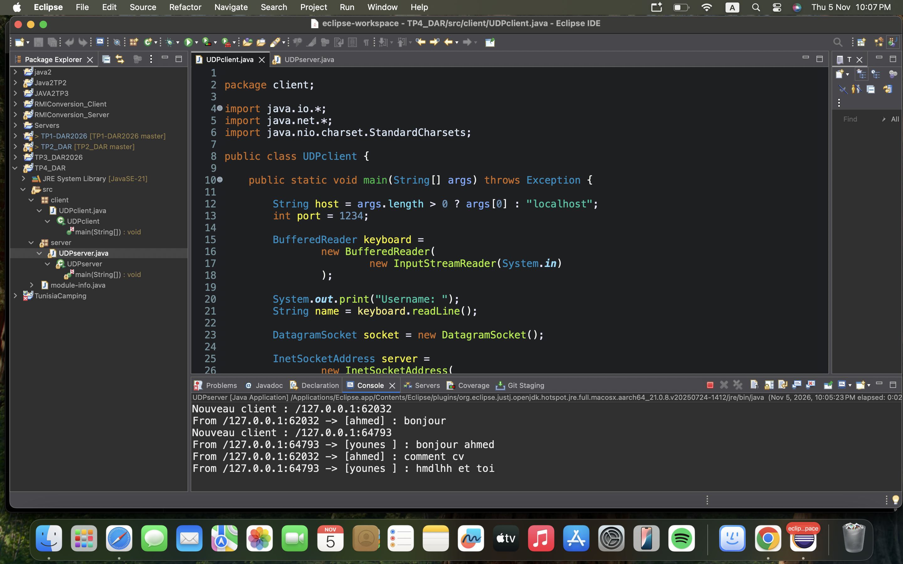
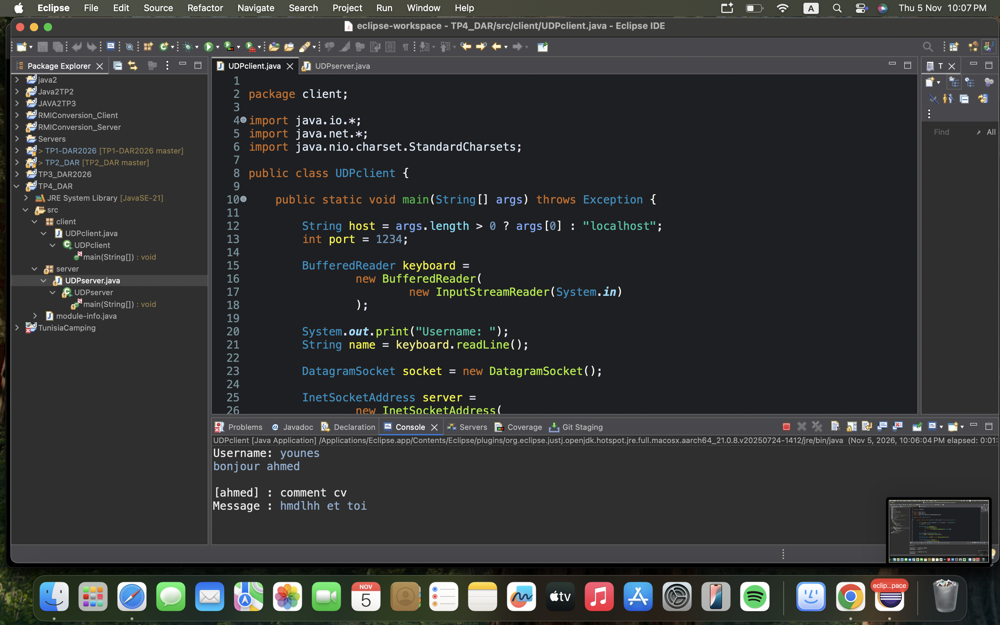

# TP 4 : Sockets en mode non-connecté UDP

## Informations générales

- **Faculté :** Faculté des Sciences de Sfax
- **Département :** Informatique et des Communications
- **Matière :** Développement d'applications réparties
- **Responsable du cours :** Amal ABID
- **Enseignante des TPs :** Zeineb DAOUD
- **Niveau :** LSI 3
- **Année universitaire :** 2026-2027
- **Environnement :** Java JDK 21 et Eclipse IDE

---

## 1. Présentation du TP

Ce TP consiste à développer une application de chat client-serveur en Java en utilisant le protocole UDP.

L'objectif est de permettre à plusieurs clients d'échanger des messages texte à travers un serveur UDP.

Le serveur écoute sur le port 1234, reçoit les messages des clients et les diffuse aux autres clients enregistrés.

## 2. Objectifs

- Maîtriser l'utilisation des sockets UDP avec DatagramSocket.
- Utiliser DatagramPacket pour envoyer et recevoir des messages.
- Utiliser InetSocketAddress pour la liaison du serveur.
- Permettre à plusieurs clients de communiquer avec le serveur.
- Enregistrer les adresses des clients.
- Diffuser les messages aux autres clients.
- Utiliser les threads pour gérer simultanément l'envoi et la réception des messages.

## 3. Structure du projet

Le projet Eclipse est organisé comme suit :

```text
TP4_DAR/
│
├── src/
│   ├── client/
│   │   └── UDPclient.java
│   │
│   └── server/
│       └── UDPserver.java
│
├── captures/
│   ├── serveur-udp.png
│   └── client-udp.png
│
└── README.md
```

## 4. Réalisation du TP

### Étape 2 : Chat unidirectionnel et test avec un seul client

Dans cette étape, nous avons développé un serveur UDP qui écoute sur le port 1234.

Le client permet :
- De saisir un nom d'utilisateur.
- De saisir des messages au clavier.
- D'envoyer les messages au serveur sous la forme `[NomUtilisateur] : message`.

Le serveur reçoit les messages et affiche l'adresse IP, le port de l'expéditeur ainsi que le contenu du message.

### Étape 3 : Chat bidirectionnel et diffusion à plusieurs clients

Dans cette étape, nous avons amélioré l'application pour permettre la communication entre plusieurs clients.

**Côté serveur :**

- Création d'une collection pour mémoriser les adresses des clients.
- Enregistrement des nouveaux clients.
- Réception des messages UDP.
- Affichage des messages reçus avec l'adresse de l'expéditeur.
- Diffusion des messages à tous les autres clients, sauf à l'expéditeur.

**Côté client :**

- Création d'un thread pour recevoir les messages.
- Envoi des messages au serveur.
- Réception des messages en temps réel.
- Possibilité d'écrire et de recevoir des messages simultanément.

## 5. Exécution et tests

Pour exécuter l'application :

1. Lancer le serveur UDP.
2. Lancer une première instance du client.
3. Saisir le nom du premier utilisateur.
4. Lancer une deuxième instance du client.
5. Saisir le nom du deuxième utilisateur.
6. Envoyer des messages depuis les deux clients.
7. Vérifier que chaque client reçoit les messages envoyés par les autres.

Le serveur affiche les adresses IP, les ports et les messages reçus.

### Résultat du test

Le test réalisé avec plusieurs clients montre que :
- Le serveur reçoit les messages des différents clients.
- Les clients sont enregistrés par le serveur.
- Les messages sont diffusés aux autres clients.
- Les clients peuvent envoyer et recevoir des messages.

## 6. Captures d'écran

### 6.1. Exécution du serveur UDP

Cette capture montre le serveur en fonctionnement, l'enregistrement des clients et la réception des messages envoyés.



### 6.2. Exécution du client UDP

Cette capture montre le client en fonctionnement et la réception des messages envoyés par les autres clients.



## 7. Synthèse

Ce TP nous a permis de comprendre et de mettre en pratique la communication en mode non-connecté avec le protocole UDP en Java.

Nous avons appris à utiliser DatagramSocket et DatagramPacket pour échanger des messages entre un client et un serveur.

Nous avons également développé un système de chat permettant à plusieurs clients de communiquer grâce à la diffusion des messages par le serveur.

L'utilisation des threads nous a permis de gérer simultanément l'envoi et la réception des messages côté client.

## 8. Conclusion

Ce travail pratique nous a permis de mieux comprendre le fonctionnement des communications UDP et leur utilisation dans le développement d'applications réparties.

Nous avons ainsi réalisé une application de chat client-serveur permettant l'échange de messages entre plusieurs utilisateurs.

---

**Fin du TP 4**
